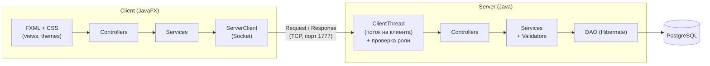
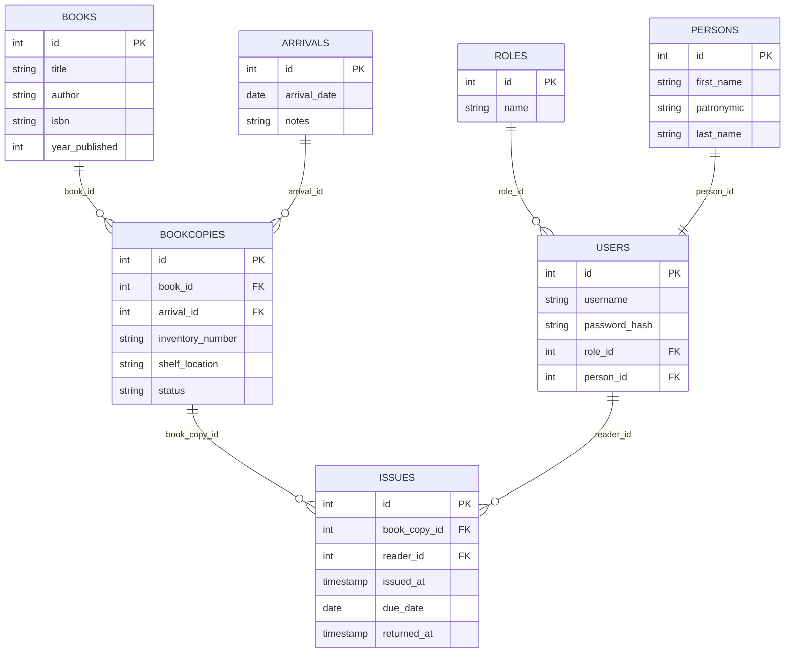

# 📚 Library Arrivals — система учёта поступлений в библиотеку


Клиент-серверное приложение для библиотеки: каталог книг, регистрация новых поступлений, учёт экземпляров и выдача книг читателям. Работа разделена по ролям (администратор, библиотекарь, читатель).

> *English summary: a client-server desktop app (JavaFX client + multithreaded Java socket server + PostgreSQL via Hibernate) for managing a library's catalog, new arrivals, physical book copies and loans, with role-based access control.*

Проект выполнен в рамках курсовой работы. Помимо кода, для него подготовлена проектная документация (UML, BPMN, IDEF0, ER-диаграммы) — см. раздел [Документация](#-документация).

---

## ✨ Возможности

- **Аутентификация и регистрация.** Пароли хранятся в виде BCrypt-хешей. Новый пользователь получает роль `Waiting` и ждёт назначения роли администратором.
- **Каталог книг:** создание, редактирование, удаление, поиск.
- **Поступления:** регистрация партий книг.
- **Экземпляры книг** с жизненным циклом: `RECEIVED → IN_FUND → ISSUED → возврат в IN_FUND`, а также списание (`WRITTEN_OFF`) и перемещение по полкам (инвентарный номер, стеллаж).
- **Выдача и возврат** книг читателям. По умолчанию срок выдачи — 14 дней; есть списки активных, возвращённых и просроченных выдач.
- **Экспорт каталога** в Excel, PDF и JSON.
- **Светлая и тёмная тема** интерфейса.
- **Разграничение прав на сервере:** доступ к каждой операции проверяется в зависимости от роли пользователя.

## 👥 Роли

| Роль | Что может |
|------|-----------|
| **Admin** | Всё, включая управление пользователями |
| **Librarian** | Каталог, поступления, экземпляры, выдачи, экспорт; без управления пользователями |
| **Reader** | Просмотр каталога и своих выдач, возврат книг, редактирование своего профиля |
| **Waiting** | Только что зарегистрированный пользователь: доступны только вход и регистрация, остальные операции сервер отклоняет |

## 🏗 Архитектура

Приложение состоит из двух независимых Maven-проектов (`Server` и `Client`), которые общаются по TCP. Сервер на каждого клиента запускает отдельный поток, проверяет права доступа по роли и обращается к БД через слои «контроллер → сервис → DAO».



**Принципы, заложенные в архитектуру:**

- Общий протокол (`Operation`, `Request`, `Response`) лежит в пакете `proj.markrone.library.api`. Клиент и сервер используют одинаковые классы с одинаковыми именами пакетов (это нужно для Java-сериализации); отдельного общего модуля нет — каждый проект содержит свою копию.
- `Request` и `Response` передаются через `ObjectOutputStream` / `ObjectInputStream`, а полезная нагрузка внутри них — JSON-строка (Gson).
- Бизнес-логика и валидация живут на сервере; клиент отвечает за интерфейс и отправку запросов.
- Слои разделены интерфейсами и базовыми классами: `DAO` / `AbstractDAO`, `Service` / `AbstractService`, `Validatable`.
- Права доступа проверяются на стороне сервера по роли пользователя (`ClientThread`), а не скрываются только в интерфейсе.

## 🗄 Модель данных



## 🛠 Технологии

| Слой | Стек |
|------|------|
| Язык / сборка | Java 21, Maven |
| Клиент | JavaFX 23 (FXML + CSS) |
| Сервер | Java Sockets, многопоточность (`ExecutorService`) |
| Работа с БД | Hibernate ORM 6.6, PostgreSQL |
| Безопасность | BCrypt (jBCrypt) |
| Сериализация | Java Serialization (`Request`/`Response`) + Gson (данные) |
| Экспорт | Apache POI (Excel), OpenPDF (PDF) |
| Логирование | Log4j2 |
| Прочее | Lombok |
| Тесты | JUnit 5 |

## 🚀 Быстрый старт

### Что нужно установить

- **JDK 21+** (проверено на 21 и 25)
- **Maven 3.9+**
- **PostgreSQL 16+**

### 1. База данных

```sql
CREATE DATABASE "Library";
```

```bash
psql -U postgres -d Library -f Sql/markrone_sql/generate.sql
```

Скрипт создаёт таблицы, роли и тестовые данные (пользователи, книги, поступления, экземпляры). Выполнять его нужно на пустой базе — до первого запуска сервера.

> 💡 Файл скрипта в кодировке UTF-8. Если в Windows вместо русского текста появились «кракозябры», перед запуском выполните `set PGCLIENTENCODING=UTF8` (cmd) или `$env:PGCLIENTENCODING="UTF8"` (PowerShell).

### 2. Настройка подключения к БД

Скопируйте шаблон и впишите пароль от своего PostgreSQL:

```bash
cp Server/src/main/resources/hibernate.properties.example \
   Server/src/main/resources/hibernate.properties
```

(в Windows: `copy Server\src\main\resources\hibernate.properties.example Server\src\main\resources\hibernate.properties`)

Файл `hibernate.properties` добавлен в `.gitignore`, поэтому пароль не попадёт в репозиторий.

Порт и адрес сервера при необходимости меняются в `Server/src/main/resources/server.properties` и `Client/src/main/resources/server.properties` (по умолчанию `127.0.0.1:1777`).

В `Server/.../server.properties` также есть `MONITORING_INTERVAL` (период вывода статистики клиентов, мс) и `SHUTDOWN_TIME` — через сколько миллисекунд без подключённых клиентов сервер завершит работу сам (по умолчанию ≈ 2 ч 47 мин).

### 3. Запуск

**Сначала сервер, потом клиент.**

```bash
# Терминал 1 — сервер
cd Server
mvn compile exec:java "-Dexec.mainClass=proj.markrone.library.server.network.Server"

# Терминал 2 — клиент
cd Client
mvn javafx:run
```

Кавычки вокруг `-Dexec.mainClass=...` нужны для PowerShell; в bash и cmd они тоже работают.

<details>
<summary>Запуск из IntelliJ IDEA</summary>

1. Откройте корневую папку проекта и выберите JDK 21 (File → Project Structure → SDK).
2. Импортируйте оба `pom.xml` как Maven-проекты (правый клик → Add as Maven Project).
3. **Сервер:** Run → Edit Configurations → Application. Main class: `proj.markrone.library.server.network.Server`, module `library-server`, working directory `Server`.
4. **Клиент:** Main class: `proj.markrone.library.client.Main`, module `library-client`, working directory `Client`. В VM options добавьте:
   `--add-opens=java.base/java.time=com.google.gson --add-opens=java.base/java.time=ALL-UNNAMED`

</details>

### Тестовые учётные записи

| Логин | Пароль | Роль |
|-------|--------|------|
| `markrone` | `2007` | Admin |
| `user1` | `password123` | Librarian |
| `user2` | `password123` | Reader |

> ⚠️ Это демонстрационные данные для локального запуска. Для реального использования смените пароли.

## 🧪 Тесты

Модульные тесты написаны на JUnit 5 (валидаторы книг и пользователей, хеширование паролей — 10 тестов):

```bash
cd Server
mvn test
```

## 📐 Документация

К проекту подготовлена проектная документация, выполненная по нескольким методологиям:

- **UML** — диаграммы классов, последовательностей, вариантов использования и др.
- **BPMN** — модели бизнес-процессов
- **IDEF0** — функциональная модель системы
- **ER-диаграммы** — модель данных

Всё собрано в одном файле: [`Documentation/Documentation.docx`](Documentation/Documentation.docx).

## 📁 Структура репозитория

```
├── Server/                     Серверная часть (Maven-проект library-server)
│   ├── src/main/java/proj/markrone/library/
│   │   ├── api/                Общий протокол: Operation, Request, Response
│   │   └── server/
│   │       ├── config/         Конфигурация Hibernate (SessionFactory)
│   │       ├── controllers/    Обработка запросов по сущностям
│   │       ├── exceptions/     Исключения
│   │       ├── interfaces/     DAO, Service, Validatable
│   │       ├── model/entities/ JPA-сущности
│   │       ├── network/        Server и ClientThread
│   │       ├── repositories/   DAO (Hibernate)
│   │       ├── serializer/     JSON-сериализация (Gson)
│   │       ├── services/       Бизнес-логика
│   │       ├── utils/          PasswordHasher, экспорт в Excel/PDF/JSON
│   │       └── validators/     Валидация данных
│   ├── src/main/resources/     hibernate.properties.example, server.properties, log4j2.xml
│   └── src/test/java/          Модульные тесты (JUnit 5)
├── Client/                     Клиентская часть (Maven-проект library-client, JavaFX)
│   └── src/main/
│       ├── java/proj/markrone/library/
│       │   ├── api/            Протокол, сущности, ServerClient (сокет)
│       │   └── client/         Main, gui/controllers, gui/services, gui/utils
│       └── resources/          views (FXML), styles (CSS-темы), images
├── Sql/markrone_sql/           Скрипт создания БД и тестовых данных
└── Documentation/              Проектная документация (UML, BPMN, IDEF0, ER)
```

## 🔭 Что можно улучшить

- Заменить Java-сериализацию объектов в сокетах на REST API / gRPC.
- Назначать роль `Waiting` при регистрации на сервере (сейчас её выставляет клиент) и проверять, что читатель изменяет только свой профиль.
- Добавить пул соединений и миграции БД (Flyway/Liquibase) вместо `hbm2ddl.auto=update`.
- Покрыть тестами сервисы и DAO (интеграционные тесты на Testcontainers).
- Добавить CI (GitHub Actions) со сборкой и запуском тестов.
